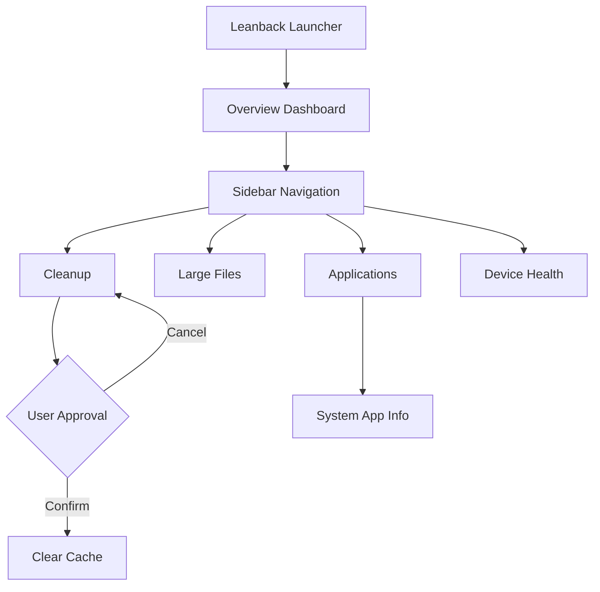

# TeeVClean 📺✨

[](https://github.com/daygle/TeeVClean/actions/workflows/android-ci.yml)
[](https://developer.android.com/tv)
[](LICENSE)

A modern, privacy-first cleaning assistant for Android TV. TeeVClean is optimized for the 10-foot experience, providing a calm and intuitive way to manage your TV's storage and health.

---

## 🌟 Features

- **Storage Health Dashboard**: Real-time summary of used and available space.
- **Cleanup**: One-tap removal of TeeVClean's own cache (internal, external, and code cache), with a clear report of how much space was freed.
- **Junk Sweep**: Remove leftover temp, log, and thumbnail files plus empty folders from the folders you grant.
- **Large File Review**: Scan folders you grant for oversized or stale files and delete them, with explicit per-file confirmation.
- **Guided App Cache**: Deep-link into each app's storage page - the only store-legal way to clear another app's cache on modern Android.
- **Applications**: Sort apps by size and quickly access system info for management.
- **Device Health**: Monitor network connectivity, system uptime, and hardware details.
- **D-Pad Optimized**: Fully navigable via remote control with clear focus indicators.
- **Privacy First**: No background deletions. Every action requires your explicit approval.

---

## 🛠 Tech Stack

- **UI**: [Jetpack Compose](https://developer.android.com/jetpack/compose) with Material 3, plus custom D-pad focus routing for the 10-foot experience (plain Compose — there is no Compose for TV dependency)
- **Build System**: Gradle 9.9.2 with **AGP 9.5.2** (Built-in Kotlin Support)
- **Language**: Kotlin 2.4+
- **Architecture**: MVI-inspired UI state management
- **Background Tasks**: [WorkManager](https://developer.android.com/topic/libraries/architecture/workmanager) for scheduled cleanups

---

## 📐 Architecture & Flow



---

## 🚀 Getting Started

### Prerequisites
- Android Studio 2026.2.2 "Rabbit 2" (or newer) — the oldest release that supports AGP 9.5
- Android SDK 37.2
- JDK 21

### Build Instructions
1. Clone the repository:
   ```bash
   git clone https://github.com/daygle/TeeVClean.git
   ```
2. Open the project in Android Studio.
3. Build and install the debug APK:
   ```bash
   ./gradlew assembleDebug
   ```

### Installation
TeeVClean runs on **Android TV 7.0 (API 24)** and above, which is the `minSdk = 24` in
`app/build.gradle.kts`. Two features need Android 11 (API 30) or newer: the all-files access
settings page and Android's system-wide "clear all app caches" prompt. On older TVs those options
are hidden and TeeVClean falls back to the folders you grant and each app's own storage settings.
For the best experience, deploy to a physical TV or a TV emulator with landscape orientation.

---

## 📄 License

Copyright 2026 daygle. Licensed under the Apache License, Version 2.0.
