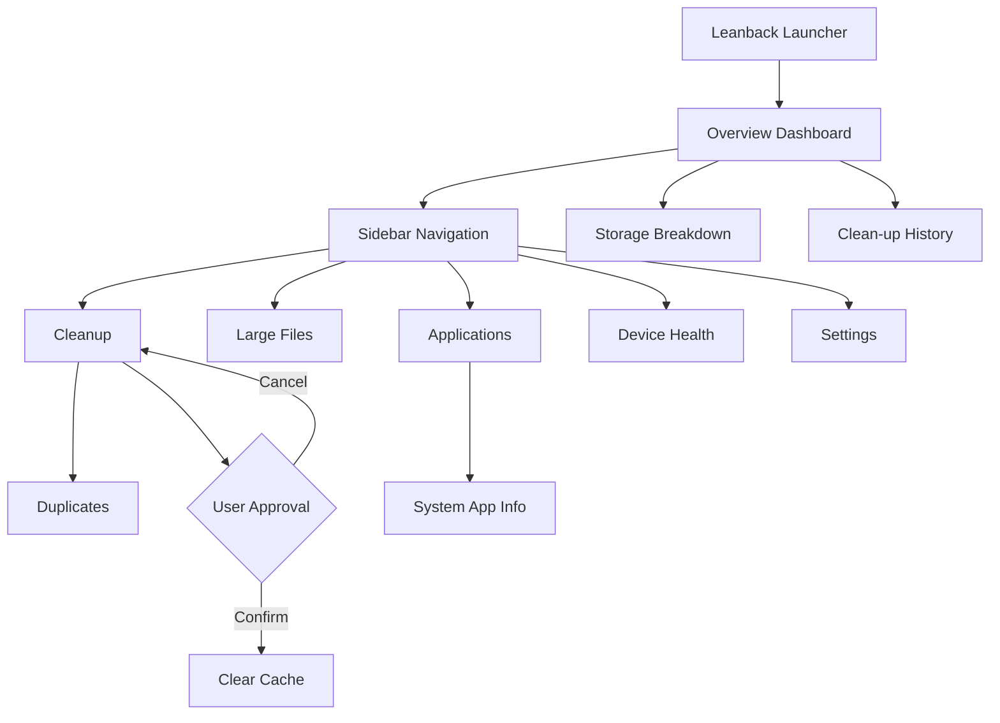

# TeeVClean 📺✨

[](https://github.com/daygle/TeeVClean/actions/workflows/android-ci.yml)
[](https://developer.android.com/tv)
[](LICENSE)

A modern, privacy-first cleaning assistant for Android TV. TeeVClean is optimized for the 10-foot experience, providing a calm and intuitive way to manage your TV's storage and health.

---

## 🌟 Features

- **Storage Health Dashboard**: Used, free and total space at a glance, refreshed whenever the app returns to the foreground and after every clean-up.
- **Cleanup**: Clear TeeVClean's own cache (internal, external, and code cache) in one pass, with a clear report of how much space was freed.
- **Junk Sweep**: Remove leftover temp, log, and thumbnail files plus empty folders from the folders you grant.
- **Large File Review**: Review oversized, stale and installer files (including APKs of apps already installed) from the folders you grant and the top of Downloads, Movies and Pictures, then delete the ones you select after a single confirmation.
- **Duplicates**: Find files in the folders you grant that share an exact size and a matching SHA-256 fingerprint sampled from the start and end of each file; each group keeps its newest copy, and the extras go only after you confirm.
- **Storage Breakdown**: See where space goes - apps and their caches, the system and everything else, and free space - with app attribution shown once usage access is granted.
- **Guided App Cache**: Open an app's system info screen, where its storage can be cleared - the only store-legal way to clear another app's cache on modern Android.
- **Applications**: Sort apps by size and jump straight to an app's system info or uninstall prompt.
- **Device Health**: Monitor storage pressure, network connectivity, system uptime, and hardware details.
- **Clean-up History**: Every manual and scheduled run logged newest first (the last 50), with the categories cleaned, item count, space freed and a marker for runs that were stopped early, plus running totals on the dashboard and a clear button.
- **D-Pad Optimized**: Fully navigable via remote control with clear focus indicators.
- **Privacy First**: Everything stays on the device, and manual deletions are confirmed first. A cleanup schedule you enable also runs unattended, but only for the categories you tick (its own cache is always included).

---

## 🛠 Tech Stack

- **UI**: [Jetpack Compose](https://developer.android.com/jetpack/compose) with Material 3, plus custom D-pad focus routing for the 10-foot experience (plain Compose — there is no Compose for TV dependency)
- **Build System**: Gradle 9.9.2 with **AGP 9.5.2** (Built-in Kotlin Support)
- **Language**: Kotlin 2.4+
- **Architecture**: MVVM — a single `AndroidViewModel` state holder over a repository, exposing Compose `mutableStateOf` state to the screens
- **Background Tasks**: [WorkManager](https://developer.android.com/topic/libraries/architecture/workmanager) for scheduled cleanups

---

## 📐 Architecture & Flow



---

## 🔐 Permissions

TeeVClean declares five permissions of its own and no `INTERNET` permission, so nothing it reads
can be uploaded. All five are in
[`app/src/main/AndroidManifest.xml`](app/src/main/AndroidManifest.xml); WorkManager merges a few
of its own into the built manifest, listed further down.

| Permission | Why it is requested | How it is granted |
| --- | --- | --- |
| `QUERY_ALL_PACKAGES` | Lists installed apps with their names and sizes for Applications, Storage Breakdown and Guided App Cache, and checks whether an APK on disk belongs to an app that is already installed. | Granted at install time. Google Play requires a declaration form for it. |
| `PACKAGE_USAGE_STATS` | Optional. Reads each app's last-used time for the Applications list, and unlocks per-app size and cache figures from `StorageStatsManager` in Storage Breakdown. | Special access the user enables in system Settings; the Settings screen opens that page. Without it, last-used dates read as unknown and apps fall back to rough sizes. |
| `MANAGE_EXTERNAL_STORAGE` | All files access: lets the built-in folder browser walk shared storage without a per-folder grant, and is required before Android will show its system-wide "clear all app caches" prompt. | Special access opened with `Settings.ACTION_MANAGE_APP_ALL_FILES_ACCESS_PERMISSION` from the Settings screen, the folder-picker fallback or the cache-clear action. **Android 11+ only**; older TVs work from the folders you grant. |
| `READ_EXTERNAL_STORAGE` | Fallback read access on Android 7-10 devices that ship no system folder picker; it is also what `hasFullStorageAccess()` checks below API 30. | Runtime prompt, launched only when the document picker is missing. |
| `WRITE_EXTERNAL_STORAGE` | Lets TeeVClean delete the shared-storage files it lists on Android 7-10, where those deletions go through the legacy permissions. Capped with `android:maxSdkVersion="29"`, so it stops existing at API 30. | Only requested when you choose TeeVClean's own folder browser on API 29 and below; the system folder picker is always tried first. Both grants are needed: with read access alone the app lists just the folders you grant, instead of offering files it cannot delete. |

`android:requestLegacyExternalStorage="true"` keeps Android 10 on the legacy storage model, so
Android 7-10 behave alike. Picking a folder through the system picker stays the default on every
version; TeeVClean only offers its own browser when that picker is missing or returns nothing,
and that fallback asks for read and write access. Android 11+ ignores the flag for an app
targeting 37 and uses all-files access instead.

### Folder grants

The folders you add are SAF grants rather than permissions. TeeVClean opens the system folder
picker (`ActivityResultContracts.OpenDocumentTree`) and keeps the grant with
`takePersistableUriPermission`, so it survives reboots until you remove the folder in Settings
or the grant is revoked. A picker that offers no persistable grant is rejected with a message
instead of failing silently later. Folders that can no longer be opened are flagged in Settings
and skipped by every scan.

### Declared capabilities

- `android.software.leanback` is **required**, and the only launcher entry point is
  `LEANBACK_LAUNCHER`, so TeeVClean installs as a TV app and has no phone launcher entry.
- Touchscreen, fake touch, telephony, camera, NFC, GPS and microphone are all declared **not
  required**, so a TV or box without them still installs.
- `android:allowBackup="false"`, and the data-extraction rules in `res/xml` exclude every domain
  from cloud backup and device transfer, so folder grants, the schedule and clean-up history
  never leave the device.
- `android:requestLegacyExternalStorage="true"` is set for Android 10, the only version that reads
  it, so that version keeps direct storage access without all-files access. Android 11+ ignores
  it for an app targeting 37.
- The `<queries>` block names three provider authorities
  (`com.android.textburrito.gdrive`, `com.android.externalstorage.photos`,
  `com.android.backup.BackupTransportService`) that the manifest comment ties to Android 12+
  backup and transfer. No Kotlin code queries them.
- WorkManager adds `WAKE_LOCK`, `ACCESS_NETWORK_STATE`, `RECEIVE_BOOT_COMPLETED` and
  `FOREGROUND_SERVICE` to the built manifest so scheduled runs can wake the device and resume
  after a reboot. `ACCESS_NETWORK_STATE` is also what Device Health reads through
  `ConnectivityManager`. None of them can move data off the device, because there is no
  `INTERNET` permission to do it with.

---

## 📁 Project Structure

```text
TeeVClean/
├── app/
│   ├── build.gradle.kts             # SDK levels, versioning, signing, R8, dependencies
│   ├── proguard-rules.pro           # keep rules used by the release build
│   └── src/
│       ├── main/
│       │   ├── AndroidManifest.xml  # leanback entry point, permissions, backup rules
│       │   ├── java/com/teevclean/app/
│       │   │   ├── MainActivity.kt      # activity, picker/permission launchers, all screens
│       │   │   ├── TeeVViewModel.kt     # UI state, Screen enum, actions to the repository
│       │   │   ├── TeeVRepository.kt    # scans, deletions, stats, prefs, scheduling
│       │   │   ├── TeeVComponents.kt    # theme, sidebar, cards, dialogs, focus helpers
│       │   │   ├── CleanupWorker.kt     # WorkManager job behind scheduled clean-ups
│       │   │   └── TeeVUtils.kt         # byte and duration formatting
│       │   └── res/
│       │       ├── drawable/            # adaptive launcher icon layers
│       │       ├── drawable-v26/        # adaptive icon for API 26+
│       │       ├── drawable-{m,h,x}dpi/ # TV banner PNGs
│       │       ├── values/              # strings.xml, styles.xml
│       │       └── xml/                 # backup and data-extraction exclusions
│       └── test/java/com/teevclean/app/
│           ├── CleanupLogicTest.kt      # classifier, filter, log codec, timing rules (25)
│           └── TeeVViewModelTest.kt     # view-model behaviour (10)
├── design/                          # brand SVGs and the visual-system notes
├── gradle/wrapper/                   # Gradle wrapper (9.9.2)
├── .github/workflows/               # android-ci.yml, release.yml
├── .github/dependabot.yml           # Gradle and Actions update PRs
├── build.gradle.kts                 # AGP and Kotlin plugin versions
├── settings.gradle.kts              # repositories and the :app module
├── RELEASING.md                     # signing, tagging and Play upload steps
└── SECURITY.md                      # data-handling notes
```

Where things live:

- **Screens and routing**: every screen is an entry in the `Screen` enum in `TeeVViewModel.kt`,
  and `TeeVCleanApp` in `MainActivity.kt` switches on `viewModel.currentScreen`. The sidebar
  lists Overview, Cleanup, Large Files, Applications and Device Health and pins Settings at the
  bottom; Storage Breakdown and Clean-up History open from Overview cards, and Duplicates opens
  from Cleanup.
- **Device work**: all file, package and storage reads in `TeeVRepository.kt`, on
  `Dispatchers.IO`. The view model holds state with `mutableStateOf` and forwards user actions.
- **Scheduled clean-ups**: `CleanupWorker` runs only the unattended-safe categories, records one
  history entry per run (including stopped or failed runs) and reschedules through the unique
  periodic work named `CLEANUP_WORK`.
- **Stored state**: a single `SharedPreferences` file, `teevclean_prefs`, holds the folder list,
  schedule, file filter and the clean-up log (capped at the last 50 entries). There is no database.
- **Copy**: user-facing text lives in `res/values/strings.xml`, with a few short labels still
  written inline in the Compose screens.

---

## 🚀 Getting Started

### Prerequisites
- Android Studio 2026.2.2 "Rabbit 2" (or newer) — the oldest release that supports AGP 9.5
- Android SDK 37.2
- JDK 21

### Build Instructions
1. Clone the repository:
   ```bash
   git clone https://github.com/daygle/TeeVClean.git
   ```
2. Open the project in Android Studio.
3. Build the debug APK:
   ```bash
   ./gradlew assembleDebug
   ```

### Installation
TeeVClean runs on **Android TV 7.0 (API 24)** and above, which is the `minSdk = 24` in
`app/build.gradle.kts`. Two features need Android 11 (API 30) or newer: the all-files access
settings page and Android's system-wide "clear all app caches" prompt. On older TVs those options
are hidden and TeeVClean falls back to the folders you grant and each app's own storage settings.
For the best experience, deploy to a physical TV or a TV emulator with landscape orientation.

---

## 📄 License

Copyright 2026 daygle. Licensed under the Apache License, Version 2.0.
